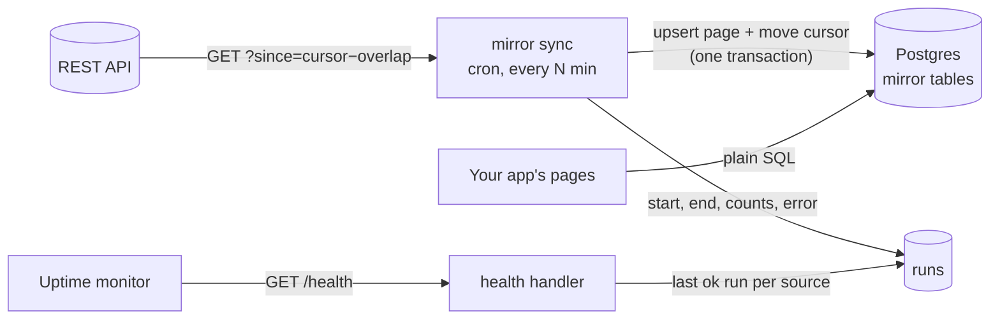
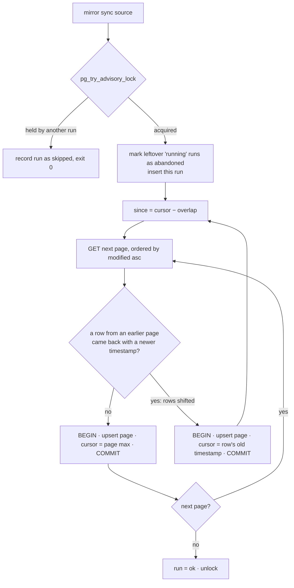

# api-mirror

Mirror a REST API into Postgres tables, incrementally, so your pages read from your own database
instead of calling someone else's API while they render.

A TypeScript library and CLI for Node 24. One runtime dependency (`pg`). It keeps a cursor per source,
writes each page and moves the cursor in one transaction, lets only one run per source write at a
time, records every run, and exposes a health endpoint that turns `stale` when a source stops syncing.

```bash
mirror backfill github_issues   # once: reads everything, resumable
mirror sync github_issues       # from cron, every few minutes: reads what changed
mirror health                   # exit 1 when a source is stale
```

## Who is this for

Your app shows data that lives in someone else's system: tickets, deals, issues, payments. Calling
that API on every page view makes your pages as slow as the API (GitHub took about 1 s per page of
100 issues), takes them down when it goes down, and burns through the rate limit. You also can't
join that data with your own in SQL.

The usual fix is a job that copies what changed into your database every few minutes. The fix itself
is easy to write. Making it correct takes more work: a run that dies halfway, two runs that overlap,
rows sharing a timestamp at a page boundary, records that change while you page through them, and a
mirror that quietly stops updating while everyone keeps trusting it. api-mirror handles those cases,
and each one has a test.

Good fit:

- **An app that reads data from a SaaS API.** Declare the source in a config file and get backfill,
  incremental sync, run history and a health check, instead of hand-writing the sync again.
- **Internal reporting.** Mirror tickets, issues or leads into Postgres and query them with SQL, or
  point Metabase at the tables.
- **Read-heavy pages over external data.** Pages read Postgres in milliseconds. The API sees one call
  every few minutes, however many people open the page.

Not a fit:

- **You need hundreds of ready-made connectors, a UI or destinations other than Postgres.** Use
  Airbyte, Fivetran or dlt. Here each source is a few lines of typed config that you write.
- **You need deletes mirrored.** They are not mirrored yet; see
  [how they would be added](#out-of-scope-and-how-deletes-would-work).
- **The API can't filter by modification time and sort by it.** Incremental sync depends on both.

## Why

I built this pattern by hand several times, for different APIs, and the rules were always the same.
This project turns those rules into a tool:

- **No page calls the external API while it renders.** It reads the mirror.
- **One writer per table.** If two runs start at once, one waits or leaves.
- **Incremental by modification time,** with a cursor per source. The cursor moves only once the batch
  is written, and every sync re-reads an overlap window so rows sharing a timestamp are not lost.
- **Idempotent upserts.** Writing the same batch twice changes nothing.
- **A runs table** (start, end, rows read and written, requests, queries, error) and **a health endpoint**
  that marks a source `stale` when its last successful run is older than its threshold.
- **A backfill separate from the incremental sync,** which resumes where it stopped if interrupted.

## How it works



A sync, step by step:



The backfill reads the whole collection in an order that never changes (creation time), saves the next
page URL in the same transaction as each page, and on completion sets the sync cursor to the moment it
started. Anything modified while it ran is picked up by the first sync.

## Quick start

Requires Node 24 and Postgres (tested on 16).

```bash
git clone <this repo> && cd api-mirror
npm install
cp .env.example .env   # set DATABASE_URL and TEST_DATABASE_URL
npm test               # 31 tests against TEST_DATABASE_URL and a fake HTTP API
```

Declare sources in a typed config (`mirror.config.ts`, or pass `--config`):

```ts
import { defineConfig } from 'api-mirror';

export default defineConfig({
  sources: [{
    name: 'tickets',
    table: 'tickets',                       // created if missing, with an index on modifiedAt
    url: 'https://api.example.com/v1/tickets',
    headers: () => ({ authorization: `Bearer ${process.env.TICKETS_TOKEN}` }),
    syncParams: { order_by: 'updated_at' },  // sync must be sorted by modification time, ascending
    backfillParams: { order_by: 'id' },      // backfill should use an order that never changes
    pagination: { type: 'cursor', param: 'page_token', next: (body: any) => body.next_page_token },
    records: (body: any) => body.data,
    sinceParam: 'updated_since',
    primaryKey: 'id',
    modifiedAt: 'updated_at',
    columns: {
      id: { type: 'bigint' },
      subject: { type: 'text' },
      assignee: { type: 'text', from: 'assignee.email' },
      tags: { type: 'text[]', from: (t: any) => t.tags.map((x: any) => x.name) },
      updated_at: { type: 'timestamptz' },
    },
    staleAfterSeconds: 15 * 60,
    overlapSeconds: 60,
  }],
});
```

```bash
npm run mirror -- backfill tickets          # resumes if interrupted; --restart to redo it
npm run mirror -- sync tickets              # --wait to queue behind a running sync instead of skipping
npm run mirror -- health                    # exit code 1 if any source is stale; --json for details
```

### Pagination

| `type` | Next page | Last page |
|---|---|---|
| `link` | the `rel="next"` URL of the `Link` header (GitHub) | no `next` link |
| `offset` | `offset += rows on this page` | a page shorter than `pageSize` |
| `cursor` | `next(body)` sent back as `param` | `next(body)` returns null |

### As a library

```ts
import { createMirror } from 'api-mirror';
import config from './mirror.config.ts';

const mirror = createMirror({ ...config, databaseUrl: process.env.DATABASE_URL });
const result = await mirror.sync('tickets');   // { status: 'ok' | 'skipped', rowsRead, rowsInserted, ... }
                                               // throws MirrorRunError (with .result) when the run fails
app.get('/health', mirror.healthHandler());    // plain (req, res) handler: node:http, Express, ...
```

`mirror.health()` returns per source: `status` (`ok` / `stale`), the reason, seconds since the last
successful run, the cursor, and the last run's status and error.

## Demo: GitHub issues

[`examples/github-issues/mirror.config.ts`](examples/github-issues/mirror.config.ts) mirrors the issues
and pull requests of a public repository (`GITHUB_REPO`, default `tj/commander.js`). It uses GitHub's
`since`, `sort=updated`/`sort=created` and the `Link` header. It was run once against the real API ([numbers](#against-the-real-github-api)), and a
test runs the same config against a fake GitHub ([`test/github-example.test.ts`](test/github-example.test.ts)).

```bash
npm run mirror -- --config examples/github-issues/mirror.config.ts backfill github_issues
npm run mirror -- --config examples/github-issues/mirror.config.ts sync github_issues
node --env-file=.env examples/health-server.ts   # GET http://localhost:3120/health
```

Without `GITHUB_TOKEN` GitHub allows 60 requests per hour. With 100 issues per page, that fits the
backfill of a repository with up to a few thousand issues.

## Design decisions

**The cursor is a timestamp, and every sync re-reads an overlap window.** Most APIs only accept
`since=<time>`, not a `(time, id)` keyset, so rows that share the cursor's timestamp cannot be told
apart. Each sync starts at `cursor − overlapSeconds` (default 60), so a crash between two pages of
same-timestamp rows, a row that lands later in the same second, an exclusive `since`, or a small
clock skew cannot drop data. The cost is re-reading whatever changed in the last minute. In the
case study that is 61 rows and 0 writes.

**A page and its cursor commit together.** The upsert and the cursor update run in one transaction,
so a crash at any point loses at most the page in flight, which the next run reads again. The
`afterCommit` and `beforeCommit` hooks exist so the tests can crash at exact points.

**Only a strictly newer version overwrites a row**
(`on conflict ... do update ... where current.updated_at < excluded.updated_at`). Replays and overlap
re-reads write nothing and leave no dead tuples. The trade-off: if an API changes a record without
bumping its modification time, the mirror will not see the change. That is a broken source, and no
incremental strategy would catch it either.

**Offset pagination shifts while the data changes, and the sync detects it.** When a row already
read is modified, it moves to the end of a list sorted by `updated_at`. Every row behind it shifts one
position back, so the row at the next page boundary is never served. The moved row always shows up
again later in the same pass with a newer timestamp. When that happens, the sync moves the cursor
back to the moved row's old timestamp, which sorts at or before any skipped row, and restarts the
pass. After `maxRestarts` (default 3) it fails without losing anything, and the next run continues
from the cursor. Six tests cover this across the three pagination styles. Disabling the detection
makes all six fail.

**One writer per source: a session advisory lock on a dedicated connection.** It is
`pg_try_advisory_lock` by default: the second run is recorded as `skipped` and exits 0, which is the
right behavior for cron. With `--wait` it uses `pg_advisory_lock` under a `lock_timeout`. If the process
dies, Postgres drops its connection and the lock goes with it. The next run marks the orphaned
`running` row as `abandoned`. A test SIGKILLs the CLI mid-sync to prove this.

**The backfill takes its start time from the earlier of our clock and the server's `Date` header.**
A client clock running ahead would otherwise put the first sync's cursor past changes made during the
backfill. The test suite's fake server runs months behind the real clock, and the test still passes
because of this.

**One SQL statement per page.** Rows go in as a single `jsonb` parameter expanded with
`jsonb_to_recordset`. That handles every column type, including `text[]` and `jsonb`, and keeps the
query count proportional to pages, not rows: 4 per page plus 5 to 8 per run.

**The health check is one query, and it does not slow down as runs accumulate.** For each source it
does a `lateral ... order by finished_at desc limit 1` against a partial index on successful runs.
That is one index probe per source. With 100,000 runs it takes 0.16 ms (plan in
[bench/RESULTS.md](bench/RESULTS.md)).

**No build step to run it.** Node 24 strips types natively, so the CLI and the config run as `.ts`.
`npm run build` emits `dist/` for publishing.

### What a source must provide

- A filter on modification time (`since`) that is inclusive, or exclusive with `overlapSeconds > 0`.
- In sync mode, results sorted by modification time, ascending. The sync checks this and fails loudly
  if it is not true.
- For the backfill, an order that never changes (creation time or id). If a record moves while
  backfilling, the run fails and says so, instead of silently skipping rows.

## Out of scope, and how deletes would work

Webhooks and a UI are out of scope. **Deletes are not mirrored**: an incremental read by `updated_at`
never sees a record that no longer exists. Two ways to add them:

1. **The API exposes tombstones** (a `deleted_at` field, or an events endpoint). Add a `deletedAt`
   column to the source config. A record with it set is upserted like any other change, and readers
   filter on `deleted_at is null` (with a partial index). No extra requests.
2. **The API does not expose them.** Run a periodic reconciliation as a separate run kind: page
   through the ids only (ideally a lightweight endpoint), stamp each one with the run id in a
   `_mirror_seen_run` column, and when the pass completes, mark the rows whose stamp is older as
   deleted. It is a full scan, so it runs daily, not every few minutes. Deletes also shift offset
   pagination without leaving a trace the sync can detect, which is a second reason to reconcile.

## Tests

`npm test`: 31 tests against a real Postgres database and a fake HTTP API
([`test/support/fake-api.ts`](test/support/fake-api.ts)) with GitHub-like semantics. Its pages are
positional, so they shift when data changes, like real ones. Nothing is mocked inside the library.

| Requirement | Test |
|---|---|
| Cut mid-batch; the retry neither duplicates nor loses rows | [`interruption.test.ts`](test/interruption.test.ts): crash inside the page transaction, HTTP 503 mid-sync, SIGKILL of the CLI |
| Same timestamp across a page boundary | [`boundary.test.ts`](test/boundary.test.ts): interruption between the pages, late rows in the same second, exclusive `since` with and without overlap |
| Two concurrent runs of one source | [`concurrency.test.ts`](test/concurrency.test.ts): skip, wait, backfill vs sync |
| A row changes between backfill and first sync | [`changes.test.ts`](test/changes.test.ts): changed during the backfill on an already-read page, and after it; rows shifting under each pagination style |
| `health` turns `stale` after the threshold | [`health.test.ts`](test/health.test.ts): never run, fresh, 1 s past the threshold, failed runs don't count, HTTP 200/503 |

Plus [`basics.test.ts`](test/basics.test.ts) (each pagination style end to end, idempotent replay,
resumable backfill, guards such as never following a `Link` to another origin) and the GitHub config test.

## Case study

`npm run case-study` runs these scenarios against the fake API on localhost and a local Postgres 16
(i5-11400H, WSL2), and writes [bench/RESULTS.md](bench/RESULTS.md). "Latency" is an artificial delay
added to each response.

| Scenario | Rows read | Rows written | HTTP requests | DB queries | HTTP ms | DB ms | Total ms | Rows/s |
|---|---:|---:|---:|---:|---:|---:|---:|---:|
| Backfill 50k rows, latency 0 | 50,000 | 50,000 | 500 | 2008 | 1834 | 4874 | 6987 | 7,156 |
| Sync, 1,000 changed rows | 1,058 | 1,000 | 11 | 49 | 116 | 148 | 273 | 3,875 |
| Sync, no changes (median of 21) | 61 | 0 | 1 | 8 | 3 | 18 | 22 | - |
| Backfill 10k rows, latency 50 ms | 10,000 | 10,000 | 100 | 408 | 5466 | 1236 | 6762 | 1,479 |
| Sync, 100 changed rows, latency 50 ms | 160 | 100 | 2 | 13 | 115 | 37 | 153 | 1,046 |
| Sync, no changes, latency 50 ms (median of 11) | 61 | 0 | 1 | 8 | 54 | 16 | 70 | - |

What the numbers say:

- **A sync with no changes costs 1 request and 8 queries.** That is 22 ms locally, or 70 ms with
  50 ms of network. It re-reads 61 rows (the 60-second overlap at one change per second in the fake)
  and writes none, because the guarded upsert skips identical versions. Running it every minute is cheap.
- **Without network latency the database is the bottleneck: 9.7 ms per page of 100 rows** (4,874 ms
  over 500 pages). That is 4 statements, and one of them is a commit that waits for fsync.
  Throughput is 7,156 rows/s.
- **With 50 ms per response the backfill is network-bound.** 81% of the time is waiting on HTTP,
  at 1,479 rows/s. The obvious next step is fetching page N+1 while page N is written, which would
  bring each page close to max(HTTP, DB) instead of the sum. It isn't done yet, because it
  complicates the "cursor moves only after the write" invariant for little gain at cron cadence.
- **Health stays flat as runs accumulate:** 1.9 ms end to end with 100,000 runs (0.16 ms in
  Postgres, index-only scan).

### Against the real GitHub API

The demo was run once on 2026-10-19 against `tj/commander.js`, without a token (60 requests per hour),
from the same machine:

| Run | Pages | Rows read | Rows written | HTTP requests | HTTP ms | DB queries | DB ms | Total ms |
|---|---:|---:|---:|---:|---:|---:|---:|---:|
| Backfill | 27 | 2,627 | 2,627 | 27 | 26,925 | 116 | 427 | 27,400 |
| Sync right after, no changes | 1 | 0 | 0 | 1 | 506 | 7 | 18 | 526 |

- **Both runs together used 28 of the 60 requests: 27 for the backfill and 1 for the sync.** GitHub took
  about 1 s per page of 100 issues, so 98% of the time was waiting on GitHub and 1.6% writing to
  Postgres. That is 96 rows/s. Here the network sets the speed, not the library.
- **The idle sync read 0 rows**, not 61 like in the fake: nobody had touched the repo within the
  60-second overlap window. It cost 1 request and 7 queries, one fewer than in the case study
  because there was no page to write.
- **The mirror holds 2,627 records (1,171 issues, 1,456 pull requests),** numbered 1 to 2,658 with
  no repeated numbers. The 31 missing numbers were not checked against GitHub; transferred or deleted
  issues would explain them, and deletes are [out of scope](#out-of-scope-and-how-deletes-would-work).

## License

MIT
